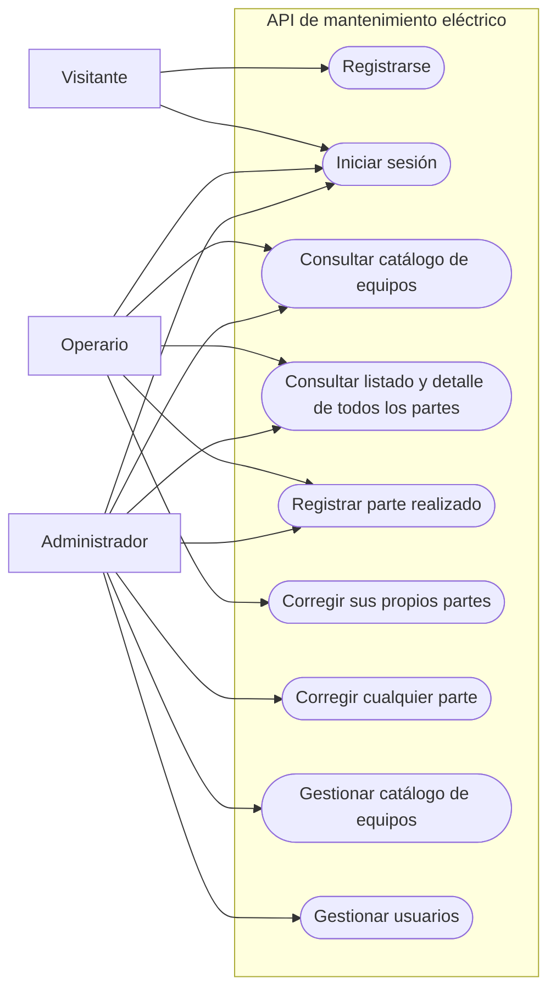
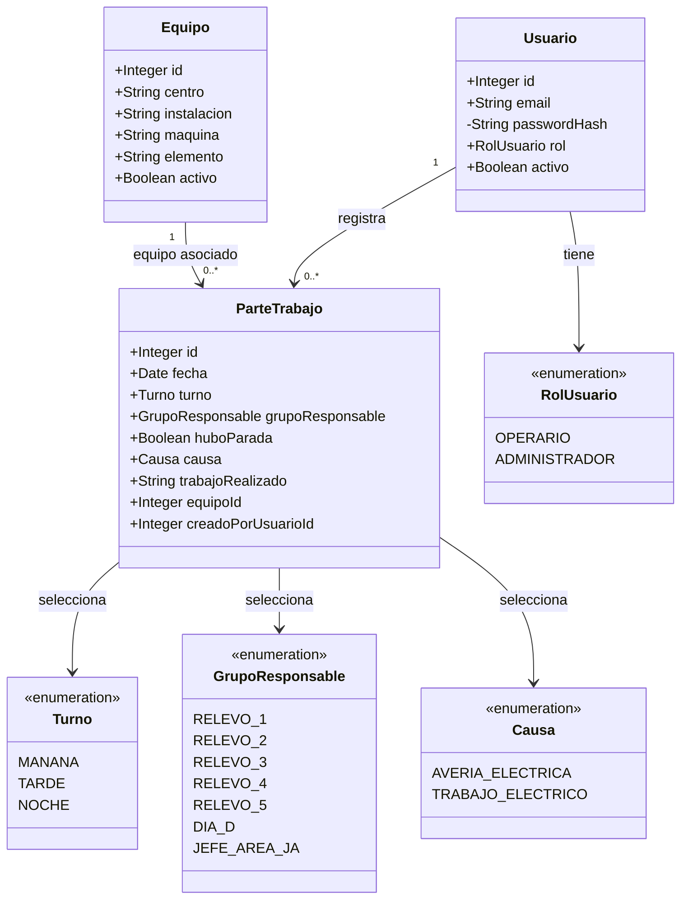
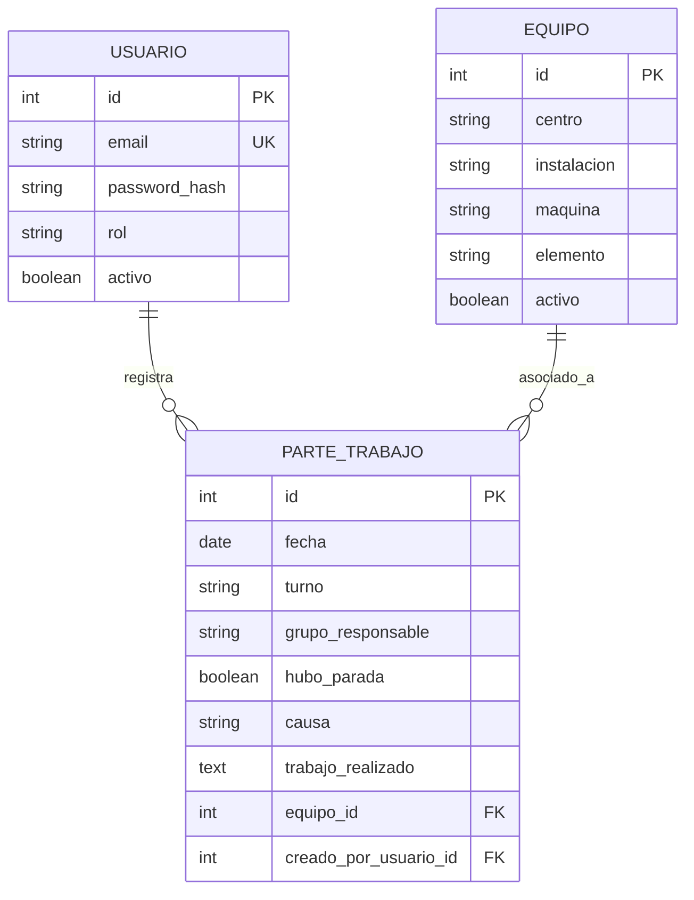
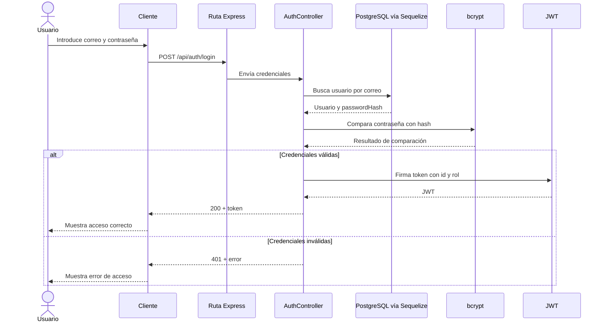
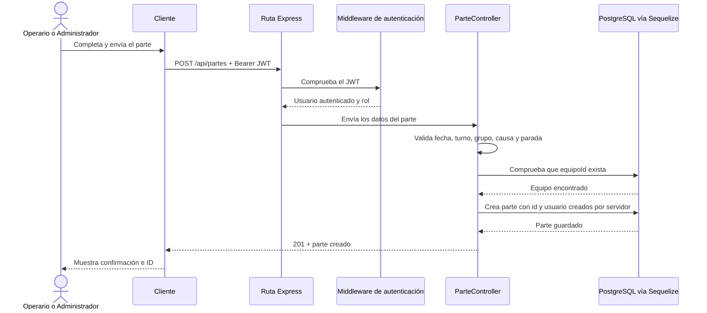
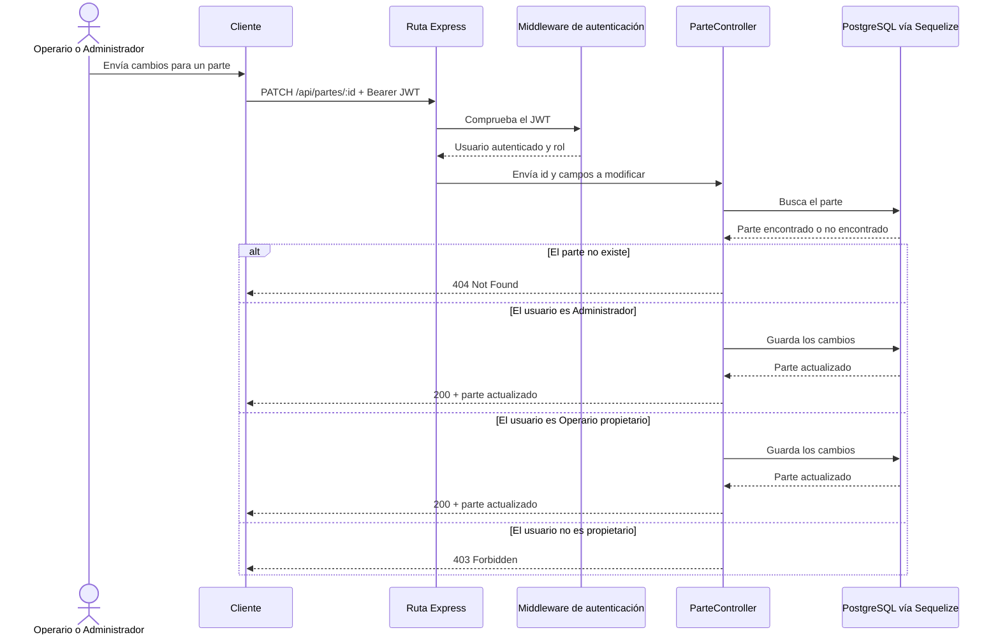
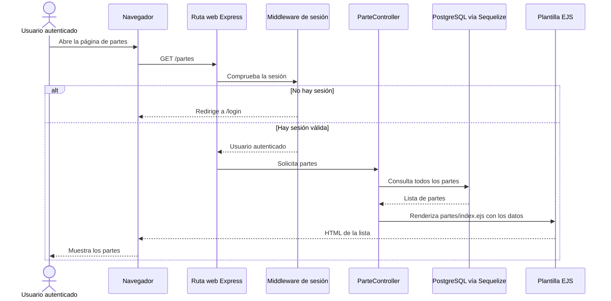

# MEMORIA DE MAINTENACE TRACKER

## Requisitos Funcionales 

### Usuarios y permisos
1.	El sistema permitirá registrar usuarios e iniciar sesión.
2.	Habrá dos roles: Administrador y Operario.
3.	Un operario podrá crear, consultar y corregir sus propios partes.
4.	Un administrador podrá gestionar el catálogo de equipos y usuarios, y consultar o corregir cualquier parte.

### Catálogo de equipos

5.	El sistema permitirá consultar los equipos disponibles para seleccionarlos al crear un parte.
6.	El administrador podrá añadir, modificar y retirar equipos del catálogo.
7.	El catálogo recogerá la ubicación del equipo —centro, instalación, máquina y elemento—

### Partes de trabajos realizados

8.	El sistema permitirá crear un parte para un trabajo ya realizado. Su identificador se generará automáticamente.
9.	Cada parte guardará la fecha, el turno, el grupo responsable, si hubo parada, la causa, la descripción del trabajo, el equipo asociado y la cuenta que lo registró.
10.	El turno se elegirá entre mañana, tarde y noche.
11.	El grupo responsable se elegirá entre los relevos 1–5, D —equipo de día— y JA —jefe de área—.
12.	La causa se elegirá entre avería eléctrica y trabajo eléctrico.
13.	El campo de parada indicará sí o no; no se registrará su duración.
14.	El equipo se seleccionará del catálogo. La descripción del trabajo se escribirá en texto libre.
15.	El sistema permitirá consultar los partes y ver el detalle de uno.

## REQUISITOS NO FUNCIONLES

Los no funcionales describen cómo debe estar construido y qué condiciones de calidad debe cumplir.
1.	`Tecnología`: el backend se desarrollará en JavaScript sobre Node.js y Express, con PostgreSQL y Sequelize.
2.	`Seguridad de contraseñas`: las contraseñas se almacenarán cifradas con bcrypt; nunca se devolverán en las respuestas de la API.
3.	`Protección de rutas`: las rutas privadas requerirán autenticación mediante JWT y comprobarán los permisos del rol correspondiente.
4.	`Gestión de secretos`: las credenciales de la base de datos y la clave JWT se leerán desde variables de entorno. El archivo .env no se subirá a GitHub; se incluirá un .env.example sin secretos.
5.	`Validación e integridad`: los datos se validarán antes de guardarlos. Las relaciones entre usuarios, equipos y partes se protegerán con claves foráneas para evitar registros inconsistentes.
6.	`Formato de la API`: las peticiones y respuestas usarán JSON y las rutas devolverán códigos HTTP adecuados. CORS se configurará para permitir la conexión con la futura aplicación React.
7.	`Mantenimiento de históricos`: un equipo asociado a partes existentes no se eliminará de forma que rompa esos registros; se podrá desactivar del catálogo.
8.	`Organización y documentación`: el código se mantendrá separado por responsabilidades —rutas, controladores, modelos y middleware— y el repositorio incluirá instrucciones claras en el README y la memoria obligatoria.

Las versiones de herramientas y los nombres de carpetas pueden cambiar durante el desarrollo; estas condiciones describen la calidad y seguridad que quieres conservar.

Con estos requisitos, los recursos principales de la API serían usuarios, equipos y partes. La búsqueda avanzada, la paginación y el ordenamiento pueden quedar como mejoras posteriores.

Aquí tienes un primer grupo de tres rutas, aparte del registro y el login:

* Método y ruta  :	Qué hace	Quién puede usarla
GET /api/equipos	Devuelve el catálogo de equipos disponibles para elegir en un parte.	

* Operario y administrador :
POST /api/partes	Registra un trabajo realizado y devuelve el ID generado.	

* Operario y administrador :
PATCH /api/partes/:id	Corrige los datos de un parte existente.	El operario que lo creó o un administrador
GET consulta datos; POST crea un registro; PATCH modifica solo algunos campos. Así ya tienes tres endpoints distintos, dos de ellos modifican la base de datos.

Como acordamos que el administrador gestiona el catálogo, después añadiremos rutas para crear y modificar equipos.

Vamos paso a paso. Diseñaremos tres rutas de negocio, aparte de registro y login. Una ruta se compone del método HTTP y la URL:
```
* GET /api/equipos
* POST /api/partes
* PATCH /api/partes/:id
``` 
La URL nombra el recurso; el método indica qué se hace con él.

1. Leer el catálogo de equipos
 ```  
* GET /api/equipos
```
  
Qué hace: devuelve los equipos que se pueden seleccionar al crear o corregir un parte.

Por qué `GET`: solo consulta información; no crea ni modifica registros.

Quién puede usarla: cualquier usuario autenticado, tanto Operario como Administrador.

Respuesta posible (`200 OK`):
```
[
  {
    "id": 12,
    "centro": "Horno eléctrico",
    "instalacion": "Horno de arco 1",
    "maquina": "Rectificador 1",
    "elemento": "Armario de pulsos"
  }
]
```

La respuesta muestra el id porque el cliente lo necesitará para asociar uno de estos equipos al parte. No tiene que enviar el nombre escrito manualmente.

1. Crear un parte
   
* POST /api/partes
  
Qué hace: registra un trabajo eléctrico que ya se realizó.

Por qué POST: crea un registro nuevo en la base de datos.
Quién puede usarla: Operario o Administrador.

El cliente enviaría los datos rellenados. Por ejemplo:
```
{
  "fecha": "2026-11-17",
  "turno": "manana",
  "grupoResponsable": "3",
  "huboParada": true,
  "causa": "AVERIA_ELECTRICA",
  "trabajoRealizado": "Se sustituyó el componente dañado.",
  "equipoId": 12
}
```

El cliente no enviaría el ID del parte ni quién lo registró:

* La base de datos generaría el ID.
* El servidor identificaría al usuario a partir del token de login.
* equipoId debe corresponder a un equipo que exista en el catálogo.
  
El servidor validaría que el turno, el grupo responsable y la causa estén entre las opciones permitidas; que huboParada sea sí/no; y que la descripción y la fecha tengan valores válidos.

Respuesta posible (201 Created):
```
{
  "id": 583,
  "fecha": "2026-11-17",
  "turno": "manana",
  "grupoResponsable": "3",
  "huboParada": true,
  "causa": "AVERIA_ELECTRICA",
  "trabajoRealizado": "Se sustituyó el componente dañado.",
  "equipoId": 12
}
```
```
201 indica que se creó un recurso. 
```

Si los datos son inválidos, el servidor debería responder con un error de validación;
si el equipoId no existe, debería indicar que no encontró ese equipo.

1. Corregir un parte existente
   
* PATCH /api/partes/:id
Por ejemplo:

PATCH /api/partes/583

Qué hace: modifica solo los campos enviados de un parte existente.

Por qué PATCH: permite una corrección parcial. Si solo se quiere corregir el texto del trabajo, no hay que volver a enviar todos los demás campos.

Quién puede usarla: el Operario que creó ese parte o un Administrador. El servidor comprobaría el permiso antes de guardar los cambios.

El cuerpo podría ser solo:
```
{
  "trabajoRealizado": "Se sustituyó el componente dañado y se comprobó el funcionamiento."
}
```
El :id de la URL es un parámetro de ruta. 

En Express se leería desde req.params.id. Los campos que se quieran cambiar llegan en el cuerpo de la petición, req.body.

El servidor no debería permitir que esta petición cambie el ID del parte ni la cuenta que lo registró.
```
Respuestas habituales:
•	200 OK: se guardó la corrección.
•	400 Bad Request: algún dato enviado no es válido.
•	401 Unauthorized: falta un token de login válido.
•	403 Forbidden: el usuario no tiene permiso para corregir ese parte.
•	404 Not Found: no existe un parte con ese ID.
```
1. Cómo encajan con autenticación y autorización
   
Las tres rutas requieren que el usuario haya iniciado sesión. El cliente enviaría el token en la cabecera:
Authorization: Bearer <token>

El token permite identificar la cuenta. Después, la autorización decide qué puede hacer esa cuenta: ambos roles pueden consultar equipos y registrar partes; al corregir un parte, el Operario solo puede modificar uno propio y el Administrador puede modificar cualquiera.
```
En Express, las declaraciones iniciales de las rutas podrían tener esta forma:
router.get('/equipos', authenticate, listEquipos)
router.post('/partes', authenticate, createParte)
router.patch('/partes/:id', authenticate, updateParte)
```
Aquí authenticate representa el middleware que valida el token. Cada controlador realizará el trabajo correspondiente. La comprobación de si el parte pertenece al Operario se hará durante la ruta de corrección.

Estas tres rutas cumplen el mínimo de tres endpoints de negocio y dos operaciones que modifican la base de datos (`POST y PATCH`). Como también acordamos que el Administrador gestiona el catálogo, más adelante habrá que añadir rutas para crear y modificar equipos.

Este diagrama representa los casos de uso que hemos definido. Las acciones de partes se refieren a trabajos ya realizados, sin estados de pendiente o en curso.

Ningún visitante podrá consultar partes sin iniciar sesión. El Visitante puede registrarse o iniciar sesión;

 una vez autenticado como Operario o Administrador, accede a las funciones correspondientes a su rol.



Así, las rutas para consultar partes también requieren autenticación. Si alguien intenta acceder sin iniciar sesión, la API debe rechazar la petición.

Cómo leerlo: cada actor está conectado con las acciones que puede realizar. Por ejemplo, el Operario puede corregir sus propios partes, mientras que el Administrador puede corregir cualquiera.

Queda por decidir cómo se crea la primera cuenta de Administrador. Por seguridad, el registro público debería crear cuentas de Operario; la cuenta inicial de Administrador se puede preparar por separado.

Este diagrama muestra las **tres clases principales** y sus relaciones. 

El usuario que registra el parte queda separado del grupo responsable —relevo 1–5, D o JA— que se anota en él.




**Cómo leer las relaciones:**

- Un **Usuario** puede registrar muchos partes; cada parte queda asociado a un usuario.
- Un **Equipo** puede aparecer en muchos partes; cada parte se asocia a un equipo del catálogo.
- El rol de la cuenta (`OPERARIO` o `ADMINISTRADOR`) es distinto del grupo responsable que se anota en el parte.

El `passwordHash` se guarda en la base de datos; la contraseña original no. El ID de cada parte lo generaría PostgreSQL al crearlo.

Aquí tienes el **diagrama entidad-relación** del proyecto. Muestra las tres tablas y sus claves primarias y foráneas:



**Cómo interpretar las relaciones:**

- Un usuario puede registrar cero o muchos partes; cada parte queda registrado por un usuario.
- Un equipo puede aparecer en cero o muchos partes; cada parte está asociado a un equipo.
- `id` identifica cada registro. `equipo_id` y `creado_por_usuario_id` enlazan el parte con su equipo y con la cuenta que lo registró.
- `rol` corresponde a Administrador u Operario. `grupo_responsable` es un dato distinto: relevo 1–5, D o JA.

Así quedan **tres entidades relacionadas** .

## Rutas REST del backend

### Autenticación

| Método y ruta | Acceso | Función |
|---|---|---|
| `POST /api/auth/register` | Público | Registrar una cuenta. Por seguridad, el registro asignaría el rol Operario; no se permitiría elegir Administrador desde el formulario. |
| `POST /api/auth/login` | Público | Comprobar credenciales y devolver un JWT. |
| `GET /api/auth/me` | Usuario autenticado | Devolver los datos de la cuenta que corresponde al token. |

En una implementación segura, la primera cuenta de Administrador se crea por un proceso de configuración, no mediante el registro público.

### Equipos

| Método y ruta | Acceso | Función |
|---|---|---|
| `GET /api/equipos` | Autenticado | Consultar el catálogo para elegir un equipo. |
| `GET /api/equipos/:id` | Autenticado | Consultar el detalle de un equipo. |
| `POST /api/equipos` | Administrador | Añadir un equipo al catálogo. |
| `PATCH /api/equipos/:id` | Administrador | Corregir sus datos o desactivarlo. |

`:id` es un parámetro de ruta. Por ejemplo, `GET /api/equipos/12 `solicita el equipo con ID 12. 

Desactivarlo, en vez de borrarlo, conserva la relación con sus partes históricos.

### Partes de trabajo

| Método y ruta | Acceso | Función |
|---|---|---|
| `GET /api/partes` | Autenticado | Consultar todos los partes. |
| `GET /api/partes/:id` | Autenticado | Consultar un parte concreto. |
| `POST /api/partes` | Operario o Administrador | Registrar un trabajo realizado. |
| `PATCH /api/partes/:id` | Operario propietario o Administrador | Corregir un parte existente. |

Al crear un parte, el servidor generaría el `ID` y obtendría la cuenta que lo registra del `JWT`. 

El cliente enviaría datos como la fecha, el turno, el grupo responsable, la causa, si hubo parada, la descripción y el `ID` del equipo elegido. No enviaría `id` ni `creadoPorUsuarioId.`

Al corregir un parte, el `Operario` solo podría modificar uno propio; el `Administrador` podría modificar cualquiera. Los `GET `y `POST` de partes requieren iniciar sesión, según lo acordado.

### Usuarios

| Método y ruta | Acceso | Función |
|---|---|---|
| `GET /api/usuarios` | Administrador | Consultar las cuentas. |
| `PATCH /api/usuarios/:id` | Administrador | Cambiar el rol o activar/desactivar una cuenta. |

Para proteger el historial, se desactivan las cuentas en lugar de borrarlas físicamente.

Con `GET, POST y PATCH `ya se cubre el mínimo de tres endpoints de negocio y dos que modifican la base de datos. El resto de rutas corresponde a las funciones de gestión que acordamos.

## Rutas web EJS

| Método y ruta | Acceso | Acción |
|---|---|---|
| `GET /registro` | Público | Muestra el formulario de registro. |
| `POST /registro` | Público | Crea la cuenta Operario y redirige al login. |
| `GET /login` | Público | Muestra el formulario de inicio de sesión. |
| `POST /login` | Público | Valida las credenciales, crea la sesión y redirige a los partes. |
| `POST /logout` | Usuario autenticado | Cierra la sesión y redirige al login. |
| `GET /partes` | Usuario autenticado | Muestra todos los partes. |
| `GET /partes/nuevo` | Usuario autenticado | Muestra el formulario para crear un parte. |
| `POST /partes` | Usuario autenticado | Guarda el parte y redirige a su detalle. |
| `GET /partes/:id` | Usuario autenticado | Muestra el detalle de un parte. |
| `GET /partes/:id/editar` | Creador del parte o Administrador | Muestra el formulario de edición. |
| `POST /partes/:id/editar` | Creador del parte o Administrador | Guarda los cambios y redirige al detalle. |

### Para las páginas de administración:

| Método y ruta | Acceso | Acción |
|---|---|---|
| `GET /admin/equipos` | Administrador | Muestra el catálogo de equipos. |
| `GET /admin/equipos/nuevo` | Administrador | Muestra el formulario para añadir un equipo. |
| `POST /admin/equipos` | Administrador | Añade un equipo al catálogo. |
| `GET /admin/usuarios` | Administrador | Muestra las cuentas registradas. |

Cómo fluye una petición` EJS`
Por ejemplo, al abrir `GET `/partes:
1. Express recibe la petición.
2. El middleware comprueba que exista una sesión iniciada.
3. El controlador solicita los partes al servicio o modelo.
4. El controlador renderiza una plantilla, por ejemplo partes/index.ejs.
5. Express devuelve el HTML al navegador.
   
En cambio, `GET /api/partes` devolvería los datos en `JSON`. Ambas rutas pueden usar la misma lógica de negocio, pero devuelven formatos distintos.

En la` API REST`, los endpoints reciben o devuelven `JSON.` Estas son las rutas propuestas para el proyecto:

| Método y endpoint | Acceso | Función |
|---|---|---|
| `POST /api/auth/register` | Público | Registra una cuenta nueva como Operario. |
| `POST /api/auth/login` | Público | Valida las credenciales y devuelve un JWT. |
| `GET /api/auth/me` | Autenticado | Devuelve los datos de la cuenta del usuario. |
| `GET /api/equipos` | Autenticado | Lista los equipos del catálogo. |
| `GET /api/equipos/:id` | Autenticado | Consulta un equipo concreto. |
| `POST /api/equipos` | Administrador | Añade un equipo al catálogo. |
| `PATCH /api/equipos/:id` | Administrador | Modifica o desactiva un equipo. |
| `GET /api/partes` | Autenticado | Lista todos los partes. |
| `GET /api/partes/:id` | Autenticado | Consulta un parte concreto. |
| `POST /api/partes` | Operario o Administrador | Crea un parte de un trabajo realizado. |
| `PATCH /api/partes/:id` | Creador del parte o Administrador | Corrige un parte. |
| `GET /api/usuarios` | Administrador | Lista las cuentas registradas. |
| `PATCH /api/usuarios/:id` | Administrador | Cambia el rol o activa/desactiva una cuenta. |

`POST` crea datos y `PATCH` modifica datos. Las rutas de partes y equipos requieren iniciar sesión; el registro y el login son públicas.

Con los endpoints de negocio ya hay más de tres rutas y varias modifican la base de datos. 

Los endpoints no son las rutas `EJS`: por ejemplo, `/partes` muestra una página `HTML `en `EJS`, mientras que` /api/partes `devuelve partes en `JSON.`


Flujos principales
Estos flujos describen cómo los usuarios interactúan con la API y sus vistas EJS.
### 1. Registro e inicio de sesión
1. El visitante se registra; el sistema crea una cuenta con rol Operario.
2. El visitante envía su correo y contraseña en el login.
3. El servidor comprueba las credenciales.
4. Si son válidas, el usuario queda autenticado y puede consultar los partes.
   
El registro no debe permitir que alguien se asigne el rol de Administrador. Para la API, el login devuelve un JWT; si también usas EJS, el formulario de login crea una sesión web. Ambos pueden reutilizar la misma comprobación de credenciales.

### 2. Consultar partes
1. El usuario inicia sesión.
2. Solicita la lista de partes o uno concreto por su ID.
3. La API comprueba que está autenticado.
4. Devuelve los datos en JSON. Operarios y Administradores pueden consultar todos los partes.
### 3. Crear un parte
1. Un Operario o Administrador inicia sesión y abre el formulario.
2. Selecciona un equipo del catálogo y completa fecha, turno, grupo responsable, parada, causa y trabajo realizado.
3. El servidor valida los valores y comprueba que el equipo exista.
4. La base de datos crea el parte con un ID automático y lo asocia a la cuenta que lo registró.
5. La API confirma la creación y devuelve el parte, incluido su ID.
### 4. Corregir un parte
1. El usuario autenticado solicita editar un parte.
2. El servidor busca el parte y comprueba que existe.
3. Si el usuario es Administrador, puede corregirlo. Si es Operario, debe ser quien registró ese parte.
4. El servidor valida los cambios y actualiza los campos permitidos.
   
Si el parte no existe, la API responde que no lo encontró. Si el Operario intenta modificar el parte de otra cuenta, responde que no tiene permiso.
### 5. Administrar el catálogo y las cuentas
- El Administrador inicia sesión y puede añadir o modificar equipos, y activar o desactivar cuentas de usuario.
- Los equipos asociados a partes antiguos se desactivan en vez de borrarse, para conservar el historial.
Las vistas EJS muestran formularios y páginas HTML; las rutas /api/... realizan las operaciones y responden con JSON

## 1. Inicio de sesión en la API
El usuario envía sus credenciales. Si son correctas, recibe un JWT para usarlo en las rutas protegidas.


## 2. Crear un parte mediante la API
El ID y la cuenta que registra el parte los determina el servidor. El cliente solo envía los datos del trabajo y el ID del equipo elegido.


Si el token falta o no es válido, el middleware detiene la petición con 401. Si los datos no pasan la validación, el parte no se guarda.

## 3. Corregir un parte
El Operario solo puede corregir un parte que registró. El Administrador puede corregir cualquiera.


## 4. Consultar partes en una página EJS
Esta ruta devuelve HTML renderizado por EJS. También exige que el usuario haya iniciado sesión.


Diferencia clave:` GET /api/partes` devolvería `JSON`; `GET /partes` renderiza una página HTML con EJS. Ambos pueden consultar la misma base de datos mediante la misma lógica de negocio.

## Plan de desarrollo 
La prioridad será completar una API REST segura y documentada. 
| Día | Objetivo | Trabajo del día |
|---|---|---|
| **1. Cerrar el diseño** | Dejar claro qué vas a construir. | Confirmar campos de las tres entidades: usuarios, equipos y partes. Definir cómo se crea la primera cuenta Administrador y qué campos puede corregir el Operario. |
| **2. Iniciar el proyecto** | Dejar preparada la aplicación Node.js. | Inicializar npm, instalar dependencias, configurar módulos ES, scripts de inicio, `.gitignore`, `.env.example` y el servidor Express base. Crear el repositorio y subir el primer commit. |
| **3. Conectar la base de datos** | Crear el esquema PostgreSQL. | Configurar Sequelize y `sequelize-cli`. Crear migraciones para usuarios, equipos y partes, con sus claves foráneas y restricciones. |
| **4. Añadir autenticación** | Permitir registro e inicio de sesión. | Crear registro e inicio de sesión, guardar contraseñas con bcrypt, generar JWT y definir roles. El registro no debe permitir asignarse el rol Administrador. |
| **5. Crear el catálogo de equipos** | Gestionar los equipos disponibles. | Crear rutas para consultar equipos y, para Administradores, añadir, modificar o desactivar equipos. |
| **6. Registrar partes** | Implementar la acción principal del sistema. | Crear `POST /api/partes`. Validar fecha, turno, grupo responsable, causa, parada y que el equipo seleccionado exista. Generar el ID y asociar el usuario desde el token. |
| **7. Consultar y corregir partes** | Completar las operaciones principales. | Crear rutas para listar todos los partes y consultar uno por ID. Permitir correcciones al autor del parte o a un Administrador. |
| **8. Cerrar permisos y errores** | Hacer coherente el comportamiento de la API. | Aplicar permisos a cada ruta, centralizar respuestas de error y terminar la gestión básica de usuarios por parte del Administrador. Si la API principal está terminada, dedicar el tiempo restante a una vista EJS sencilla. |
| **9. Documentar** | Preparar las instrucciones y explicar decisiones. | Completar el `README.md`, documentar rutas y ejemplos de JSON, añadir JSDoc a la lógica principal y redactar decisiones, retos y soluciones para la memoria. |
| **10. Preparar la entrega** | Dejar el repositorio listo para revisión. | Completar la memoria obligatoria, revisar que documentación y proyecto coincidan, ordenar los commits y preparar el repositorio de GitHub para la entrega. |

## Errores típicos a vigilar

### Autenticación y permisos

- Permitir que alguien se registre como Administrador. El registro público debe asignar Operario; el rol no debe aceptarse libremente desde el formulario o el JSON.
- Confundir la cuenta con el grupo responsable. La cuenta identifica quién registró el parte; el grupo (relevo 1–5, D o JA) describe quién hizo el trabajo.
- Olvidar proteger GET /api/partes. Aunque solo consulte, acordamos que requiere iniciar sesión.
- No comprobar la autoría al editar. Un Operario solo puede corregir sus partes; el Administrador puede corregir cualquiera.
- Confiar en creadoPorUsuarioId enviado por el cliente. El servidor debe obtener la cuenta del JWT para evitar que alguien atribuya un parte a otro usuario.
- Mezclar JWT y sesiones sin definir para qué sirve cada uno. Para la API usaremos JWT. Las sesiones con express-session solo hacen falta si añadimos vistas EJS con login basado en sesión.
### Datos y base de datos
- Aceptar valores arbitrarios en turno, grupo responsable, causa o parada. Valida las opciones permitidas y los tipos de datos.
- Guardar el equipo como texto libre en cada parte. El parte debe guardar el ID del equipo del catálogo y el servidor debe comprobar que existe.
- Borrar equipos que aparecen en partes anteriores. Desactívalos para conservar el historial.
- Olvidar las relaciones Sequelize. Asegúrate de relacionar usuario y equipo con sus partes usando las claves foráneas correspondientes.
- Cambiar tablas automáticamente con sync({ alter: true }) sin control. Para este proyecto, utiliza migraciones con sequelize-cli y guarda los cambios del esquema en el repositorio.
### Rutas y respuestas
- Poner /:id antes de rutas fijas como /nuevo. En algunos diseños, una ruta dinámica puede interpretar “nuevo” como si fuera un ID. Declara primero las rutas fijas.
- Devolver HTML donde la API debe devolver JSON. Las vistas EJS y los endpoints /api/... son rutas distintas.
- Usar el código HTTP equivocado. Por ejemplo: 201 al crear, 401 si falta autenticación, 403 si el usuario no tiene permiso y 404 si el recurso no existe.
- Responder siempre con 500. Los errores esperados —datos inválidos, usuario duplicado, equipo inexistente— deben tener respuestas adecuadas. No envíes contraseñas, hashes ni detalles internos en los mensajes de error.
### Configuración y entrega
- Subir .env a GitHub. Incluye .env en .gitignore y comparte solo un .env.example sin secretos.
- Usar localhost como host de PostgreSQL dentro de Docker. En Docker Compose, la aplicación debe conectarse usando el nombre del servicio de base de datos.
- Olvidar la memoria obligatoria. Reserva tiempo para README y memoria. Como el proyecto es individual, explica que no hubo reparto entre varias personas y describe las tareas que realizaste tú.
  
Los errores que más afectarían este proyecto son: registro de Administradores sin control, ausencia de claves foráneas, permisos mal comprobados al corregir partes y datos reales publicados en el repositorio.